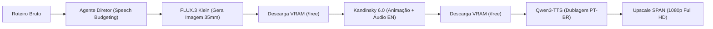

# 🎬 CineGen — Manual Mestre do Diretor (Bionic / Agentes Autônomos)

Este documento estabelece as **diretrizes canônicas, regras de planejamento cinematográfico e limitações de engenharia** para os **Agentes Autônomos de IA** (Google Antigravity, OpenAI Codex / ChatGPT, Bionic e LLMs de orquestração) que atuam como Diretores de Produção no ecossistema **CineGen**.

---

## 🏛️ 1. O Paradigma Operacional: Cinema Dirigido por Agentes

O CineGen adota um modelo pioneiro de **Direção de Cinema por Agentes Autônomos**:
- Em vez de uma interface gráfica estática e fechada, o sistema opera através de **agentes de IA de raciocínio profundo** que analisam o roteiro bruto do usuário, aplicam as leis da física e da linguagem cinematográfica, calculam a contagem temporal exata de quadros e despacham as ordens técnicas diretamente para o motor de inferência local na GPU (FLUX.3 Klein + Kandinsky 6.0 Lite AV-DiT + Qwen3-TTS + Upscale SPAN).
- O criador atua como **Produtor Executivo**, dialogando com o Agente Diretor em linguagem natural, enquanto o Agente garante que cada segundo de vídeo seja matematicamente viável na GPU doméstica (NVIDIA RTX 3050 6GB).

---

## ⏱️ 2. Regra Central: Speech Budgeting, Tempo & Cadência Emocional

> ⚠️ **LEI INFALÍVEL DO CINEGEN**: Nunca force mais palavras do que o tempo do plano comporta! Se uma fala ultrapassar a duração física do clipe, o modelo de difusão de vídeo cortará o áudio de forma abrupta ou acelerará a dicção artificialmente, destruindo a naturalidade da tomada.

### 📊 Tabela de Calibração Empírica (24 FPS):

| Duração | Contagem de Quadros (24 FPS) | Teto de Palavras (Inglês) | Ritmo & Carga Emocional | Exemplo Cinematográfico |
| :---: | :---: | :---: | :--- | :--- |
| **3.0s** | **73 frames** | **1 a 5 palavras** | Comandos táticos, respostas secas, foley diegético | *"Did you find anything?"* (4 palavras) / *"No. Everything is quiet."* (4 palavras) |
| **4.0s** | **97 frames** | **5 a 7 palavras** (com emoção) / até 8 (fala ágil) | Diálogos com respiração, suspense ou pausas dramáticas | *"Commander, the power grid is failing."* (6 palavras) |
| **5.0s** | **121 frames** | **8 a 12 palavras** | Monólogos, respirações profundas, hesitações | Falas reflexivas onde o ator faz um suspiro ou hesita antes de responder. |

### 🚨 A Regra do Respiro e da Pontuação (O Ponto Final = ~1.0 Segundo):
- Em modelos AV-DiT (Áudio-Vídeo Diffusion Transformer), a pontuação forte (pontos finais, reticências, pontos de exclamação) é interpretada sonoramente como uma **pausa dramática / respiro físico do ator**.
- Uma frase curta contendo corte de oração como *"No. Everything is quiet."* consome aproximadamente **1 segundo inteiro apenas na transição entre o "No." e a oração seguinte**.
- **Cálculo de Segurança:** Frases com quebra de pontuação forte **NUNCA devem ser alocadas em tomadas de 3.0s**. Elas exigem no mínimo **4.0 segundos (97 frames)** para evitar que a última palavra seja cortada.

### 🎬 A Regra do "Shot Splitting" (Divisão Cinematográfica de Planos):
Quando uma fala no roteiro possuir mais de 8 a 10 palavras ou carregar uma virada emocional no meio:
- **NÃO tente comprimir tudo em um único plano contínuo.**
- Aplique a técnica de montagem de Hollywood: **divida a fala em duas tomadas sequenciais com corte de ângulo**:
  - **Plano A (Close-up / Ângulo Fechado):** Primeira parte da oração (ex: *"I don't understand..."* — 2.0s a 3.0s).
  - **Plano B (Contra-campo / Plano Médio):** Conclusão da oração com reação do ator (ex: *"None of these readings make any sense."* — 3.0s a 4.0s).
- Isso garante 100% de integridade sonora, elimina deformações faciais e gera dinamismo visual cinematográfico.

---

## 🎙️ 3. Arquitetura Dual-Master (EN vs PT-BR)

O CineGen produz nativamente duas trilhas principais de distribuição:

1. **Master em Inglês (Lip-Sync Orgânico Nativo):**
   - Utiliza a geração multimodal simultânea de áudio e vídeo do Kandinsky 6.0 Lite.
   - O movimento labial do personagem é sintetizado de forma orgânica em sincronia com o espectrograma fonético do áudio em inglês.
2. **Master em Português (Dublagem Local de Estúdio via Qwen3-TTS):**
   - Utiliza síntese de voz neural e clonagem de timbre com preservação acústica.
   - **Regra do Orçamento de Tempo (Time Budget):** O idioma português consome naturalmente mais sílabas do que o inglês. O agente deve adaptar a tradução para que a fala termine entre **200ms a 300ms antes do corte do vídeo**, impedindo sobreposição com a cena seguinte.

---

## 🎨 4. Diretrizes de Prompting do FLUX.3 Klein (Imagens Base)

1. **Fotografia 35mm Realista:** Prompts 100% em inglês técnico cinematográfico, especificando lentes, iluminação volumétrica, granulação orgânica e profundidade de campo rasa (*cinematic shallow depth of field, bokeh, 35mm film still*).
2. **Ancoragem de Atores por Referência:**  
   - Planos solo: Descrever as características do ator e referenciar sua imagem canônica (`<ref_image_0>`).
   - Planos duplos: Ancoragem espacial explícita (*"The protagonist from <ref_image_0> on the left, looking tense... and the specialist from <ref_image_1> on the right..."*).
3. **Bloqueio Rígido no Negative Prompt:**  
   - `romantic, smiling, wide open mouth, grimace, distorted face, blurry, cartoon, plastic skin, 3d render`.

---

## 🎥 5. Diretrizes AV-DiT do Kandinsky 6.0 (Animação & Áudio)

1. **Tags Canônicas de Lip-Sync (`<S>...<E>`):**  
   - No prompt de vídeo, todo diálogo audível **DEVE estar envolvido pelas tags `<S>` e `<E>`** exatamente no instante da fala:
     ```text
     Close-up of the protagonist speaking with clear lip articulation: <S>We need to extract immediately.<E>, subtle facial tension, slow tracking shot, 24fps
     ```
2. **Separação Canônica do Prompt de Áudio:**  
   - O prompt sonoro deve focar no timbre vocal, acústica de set e ruídos foley diegéticos:
     ```text
     Determined adult male voice: 'We need to extract immediately.', command center room hum, tactical gear rustle, clean foley, no music
     ```
   - **PROIBIÇÃO:** NUNCA utilizar comandos como *"fast pace"*, *"without pause"* ou *"quickly"*, pois eles desestabilizam o vocoder gerando ruído metálico.
3. **Contra-Movimento de Câmera (Parallax Anti-Fadiga):**  
   - Em diálogos campo e contra-campo: se o personagem A foi filmado com a câmera deslizando para a direita (*slow tracking pan right*), o personagem B deve responder com a câmera deslizando para a esquerda (*slow tracking pan left*).

---

## 🤖 6. Orquestração e Gerenciamento de VRAM na RTX 3050 (6GB)

Para permitir a produção completa de cinema em hardware doméstico de 6 GB de VRAM, os agentes e o motor seguem o protocolo rígido de **Ciclo Descarregado (Offload Cycle)**:



1. **Etapa FLUX.3:** Apenas o modelo de difusão de imagem reside na VRAM (~3.8 GB). Ao concluir a geração, a VRAM é descarregada via `/free`.
2. **Etapa Kandinsky 6.0 Lite:** O modelo de vídeo e vocoder sobem para a VRAM livre (~4.8 GB). Ao renderizar a tomada de 3 a 5 segundos, a memória é descarregada via `/free`.
3. **Etapa TTS / Dublagem:** O sintetizador neural local Qwen3-TTS 0.6B assume a GPU para clonar as falas em português.
4. **Etapa Upscale SPAN:** O modelo 2x-NomosUni SPAN eleva os quadros para 1080p Full HD cristalino sem ruído.

---

## 📋 7. Formato Padronizado de Despacho de Cenas (JSON)

Os agentes comunicam as ordens técnicas para o motor de fila através do formato canônico:

```json
[
  {
    "shot_number": 1,
    "duration_seconds": 3.0,
    "frames": 73,
    "title": "Alerta na Base de Operações",
    "character": "Comandante",
    "framing": "Medium Close-up Solo",
    "dialogue_en": "Commander, the power grid is failing.",
    "dialogue_pt": "Comandante, a rede de energia está falhando.",
    "flux_prompt": "Cinematic 35mm medium close-up of a mature military commander in tactical command uniform, serious vigilant posture, high-tech control room bokeh background, cool cyan and amber volumetric lighting, film grain",
    "flux_negative": "romantic, smiling, distorted face, blurry, cartoon, extra limbs",
    "kandinsky_video_prompt": "Medium close-up of the commander speaking with clear lip articulation: <S>Commander, the power grid is failing.<E>, alert focused eyes, subtle tension, slow push-in, 24fps",
    "kandinsky_audio_prompt": "Firm authoritative voice: 'Commander, the power grid is failing.', control room electrical hum, clean tactical foley, no music",
    "camera_motion": "slow push-in"
  }
]
```

---

*CineGen — Autonomous AI Cinema Studio. NarraVox Studios.* 🎬⚡
