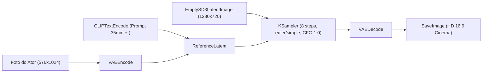

# Guia Oficial CineGen: Geração de Imagens com Fidelidade Real

Este documento estabelece as diretrizes definitivas e os padrões técnicos para a geração de imagens de alta fidelidade no **CineGen**, utilizando o modelo **FLUX.3 Image Klein** em ambiente local com a NVIDIA GeForce RTX 3050 (6 GB VRAM).

---

## 1. As Regras de Ouro do FLUX.3 (Validadas na Prática e pela Comunidade Reddit) 💡

Durante os testes práticos com personagens reais (Paulo, Carol, Cida e Pai) e pesquisas na comunidade (*r/StableDiffusion*, *r/FluxAI*, *r/comfyui*), consolidamos as regras essenciais para obter máxima semelhança facial, poses orgânicas e evitar o aspecto "inchado" ou artificial:

> [!CAUTION]
> **1. NUNCA use "Sopa de Tags" (*8k, photorealistic, masterpiece, hyper-detailed*)!**
> 
> O FLUX.3 opera com codificador T5/Qwen-VL que entende linguagem natural. Palavras como *"photorealistic"* ou *"masterpiece"* ativam filtros digitais de alisamento excessivo, gerando pele plástica e rostos **inchados/arredondados**. 
> Em vez disso, use termos da fotografia real: `candid 35mm film photograph, natural skin texture, soft evening lighting`.

> [!IMPORTANT]
> **2. NUNCA use rótulos de gênero genéricos (*man / woman*) no prompt de referência!**
> 
> Usar *"man"* ou *"woman"* força o modelo de linguagem a injetar estereótipos textuais (como alargar o queixo ou criar maçãs do rosto genéricas de modelo) por cima da foto real.
> **Instrua a IA usando exclusivamente as tags visuais:** `<ref_image_0>` e `<ref_image_1>`. A IA de visão já sabe quem é quem!

> [!IMPORTANT]
> **3. NUNCA descreva traços físicos óbvios no texto (barba, formato do nariz, etc.)!**
> 
> A IA de visão extrai a barba, o sorriso e o formato dos olhos **diretamente da foto**. Quando você escreve "trimmed neat beard", o modelo substitui a sua barba autêntica por uma barba genérica de IA.

> [!TIP]
> **4. Enquadramento da Imagem de Referência: Busto / Rosto para Máxima Resolução!**
> 
> Se a foto de entrada for de corpo inteiro ou plano distante, ao reduzir para 576x1024 o rosto terá poucos pixels. Sempre use um recorte de **busto/rosto (close-up ou meio-busto)** em 576x1024 para fornecer alta densidade de detalhes faciais à IA.

> [!TIP]
> **5. A Física da Pose: Foco no Carinho (Sem Objetos Concorrentes)!**
> 
> - **O que gera conexão real (Ex: Foto do Parque):** Descrever o abraço como entrega mútua (`<ref_image_1> resting head gently on the shoulder of <ref_image_0> with arms wrapped around, natural loving hug`).
> - **O que endurece a pose:** Adicionar comandos de apoio como *"leaning against ship railing"*. Objetos no cenário forçam a IA a dividir a física dos corpos, deixando o casal com postura rígida de catálogo.

> [!TIP]
> **6. Desempenho Calibrado: 8 Passos é o Ideal!**
> 
> O FLUX.3 Klein é um modelo destilado rápido da Black Forest Labs feito para 8 passos. 
> - 8 passos: **~90s** (solo) / **~118s** (dupla) com 100% da nitidez e sem artefatos.

---

## 2. Estrutura Oficial do Prompt (Os 4 Blocos do Reddit + Docs FLUX)

$$\text{[Fotografia / Estilo 35mm]} \rightarrow \text{[Sujeitos com Tags Visuais]} \rightarrow \text{[Ação / Abraço Afetivo]} \rightarrow \text{[Cenário Criativo / Luz Suave e Bokeh]}$$

### Exemplo Modelo para Casal (Padrão Ouro):
```text
A candid 35mm film photograph of a loving couple in a warm affectionate embrace at twilight. <ref_image_0> and <ref_image_1>, completely faithful to their authentic faces, natural skin texture, and genuine joyful smiles. The person from <ref_image_1> has arms gently wrapped around the neck and shoulder of <ref_image_0>, resting head affectionately close, while <ref_image_0> holds them in a natural loving hug. A stunning picturesque coastal promenade with soft evening lantern lights, gentle sea breeze, dreamy colorful bokeh, warm cinematic twilight lighting
```

---

## 3. Padrão 1: Personagem Solo (1 Ator na Cena)

Quando a cena tiver apenas uma pessoa (ex: Cida na praia tropical, Paulo no laboratório, Pai no campo):

### A. Preparação da Imagem de Entrada
1. **Orientação EXIF:** Sempre corrigir fotos de celular com `ImageOps.exif_transpose`.
2. **Proporção da Referência:** Padronizada em **576x1024** (proporção vertical 9:16) com enquadramento focado do peito para cima.

### B. Estrutura do Workflow (ComfyUI)


---

## 4. Padrão 2: Multi-Referência (Casal / Dupla)

Quando a cena exigir duas pessoas interagindo:

### A. Tags Oficiais do FLUX.3
- Ator 1: `<ref_image_0>` (ex: Paulo em `paulo.jpg`)
- Atriz 2: `<ref_image_1>` (ex: Carol em `carol_original_full.png`)

### B. Encadeamento Serial no ComfyUI
1. **LoadImage 1** -> `VAEEncode` -> **`ReferenceLatent 1`** (Índice 0 = `<ref_image_0>`).
2. **LoadImage 2** -> `VAEEncode` -> **`ReferenceLatent 2`** ligado na saída do anterior (Índice 1 = `<ref_image_1>`).
3. Saída do `ReferenceLatent 2` alimenta o `positive` do `KSampler`.

---

## 5. Configuração Otimizada de Renderização (RTX 3050 - 6 GB VRAM)

| Parâmetro | Valor Recomendado | Justificativa Técnica |
| :--- | :--- | :--- |
| **Resolução de Saída** | `1280x720` (16:9) | Padrão cinematográfico HD nativo |
| **Passos (Steps)** | **`8` passos** | Convergência perfeita do FLUX.3 Klein em menos de 2 minutos |
| **Sampler** | `euler` | Amostragem determinística para flow-matching |
| **Scheduler** | `simple` | Curva linear ideal para o FLUX.3 |
| **CFG** | `1.0` | Guidance 1.0 nativo (sem queimar cores nem distorcer) |
| **Negative Prompt** | *Vazio ("")* | FLUX não utiliza negative prompts tradicionais |
| **Tempo Médio Solo** | **~90 segundos** | VRAM dedicada ao unet (~2.8 GB livres) |
| **Tempo Médio Dupla** | **~118 segundos** | VRAM dividida com 2 imagens (~1.6 GB livres) |

---

## 6. Checklist Definitivo de Geração CineGen

- [ ] A foto de referência foi corrigida para orientação vertical em pé (`exif_transpose`)?
- [ ] O enquadramento da referência é de busto/rosto para garantir alta densidade de pixels?
- [ ] As tags oficiais `<ref_image_0>` e `<ref_image_1>` estão presentes?
- [ ] O prompt **NÃO** contém rótulos como *"man"*, *"woman"*, *"beautiful"*, *"handsome"*?
- [ ] O prompt **NÃO** contém sopa de tags como *"8k"*, *"photorealistic"*, *"masterpiece"*?
- [ ] A pose foca no carinho orgânico (cabeça no ombro) sem barras ou parapeitos dividindo a física dos corpos?
- [ ] O KSampler está em **8 passos**, sampler `euler`, scheduler `simple` e CFG `1.0`?
