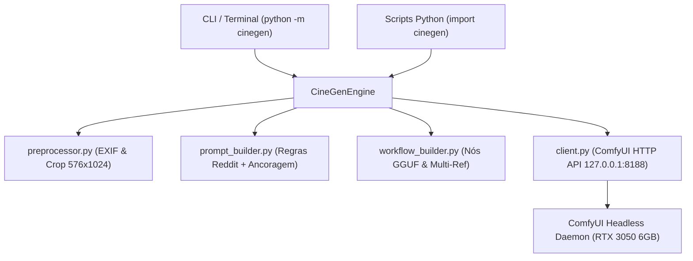

# Sistema Python CineGen — Guia de Arquitetura e Uso

O **CineGen** agora possui um sistema Python oficial e modularizado (`cinegen`), projetado para automatizar todo o pipeline de geração de imagens cinematográficas com o ComfyUI e FLUX.3 Klein de forma 100% autônoma.

---

## 1. Arquitetura Modular (`c:\CineGen\cinegen`)



### Componentes:
- **`preprocessor.py`**: Normaliza fotos de smartphone (corrige rotação EXIF, remove barras de stories e ajusta o enquadramento de busto/rosto em 576x1024 vertical).
- **`prompt_builder.py`**: Aplica a fórmula oficial validada (linguagem fotográfica 35mm/85mm, sem 'man/woman', sem '8k/photorealistic' e com ancoragem espacial).
- **`workflow_builder.py`**: Monta dinamicamente a malha de nós do FLUX.3 Klein com GGUF e encadeamento serial de `ReferenceLatent`.
- **`client.py`**: Comunicação robusta via API HTTP com o ComfyUI em `127.0.0.1:8188`.
- **`engine.py`**: Motor central que expõe os métodos de alto nível `generate_solo()` e `generate_couple()`.
- **`cli.py` / `__main__.py`**: Linha de comando direta no terminal.

---

## 2. Como Usar pela Linha de Comando (CLI)

No terminal dentro de `C:\CineGen`:

### A. Verificar se o servidor está pronto:
```bash
python -m cinegen status
```

### B. Gerar Personagem Solo (com opção de cabelo loiro):
```bash
python -m cinegen solo --actor "atores narravox/paulo.jpg" --scenario "um resort tropical ao entardecer"
```
Para estilizar o cabelo loiro:
```bash
python -m cinegen solo --actor "amiga.png" --scenario "terraço com vista para o mar" --blonde
```

### C. Gerar Foto de Casal (com Ancoragem Espacial e Multi-Referência):
```bash
python -m cinegen couple --left "atores narravox/paulo.jpg" --right "amiga.png" --scenario "parque de diversões ao crepúsculo com luzes de roda-gigante" --blonde
```

---

## 3. Como Usar via Código Python (`import cinegen`)

Em qualquer script ou projeto Python:

```python
from cinegen import CineGenEngine

engine = CineGenEngine()

# 1. Geração Solo
resultado_solo = engine.generate_solo(
    image_path="atores narravox/paulo.jpg",
    scenario="um mirante costeiro no pôr do sol",
    steps=8
)
print(f"Salvo em: {resultado_solo.output_path} (em {resultado_solo.elapsed_seconds}s)")

# 2. Geração de Casal
resultado_casal = engine.generate_couple(
    left_image_path="atores narravox/paulo.jpg",
    right_image_path="comfyui/input/amiga2_reference.png",
    scenario="parque de diversões com bokeh e luzes douradas",
    right_hair="long flowing golden blonde hair",
    steps=8
)
print(f"Casal salvo em: {resultado_casal.output_path} (em {resultado_casal.elapsed_seconds}s)")
```
